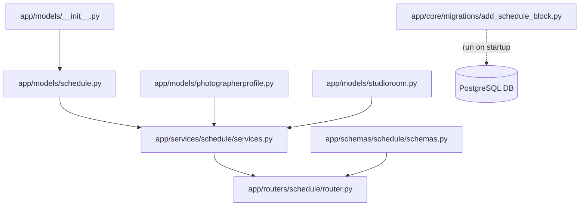

# PicNest Schedule Management Module - Файлы модуля

Этот файл содержит полный список всех созданных файлов для модуля управления расписанием.

## 📁 Структура файлов

### Модели данных (app/models/)

| Файл | Описание | Статус |
|------|----------|--------|
| [schedule.py](../app/models/schedule.py) | ORM модели: ScheduleTemplate, ScheduleException, ScheduleBlock | ✅ Создан |

### Схемы валидации (app/schemas/schedule/)

| Файл | Описание | Статус |
|------|----------|--------|
| [schemas.py](../app/schemas/schedule/schemas.py) | Pydantic v2 схемы для всех endpoints | ✅ Создан |

### Бизнес-логика (app/services/schedule/)

| Фил | Описание | Статус |
|-----|----------|--------|
| [services.py](../app/services/schedule/services.py) | Сервисы для CRUD операций и валидации | ✅ Создан |

### API endpoints (app/routers/schedule/)

| Файл | Описание | Статус |
|------|----------|--------|
| [router.py](../app/routers/schedule/router.py) | RESTful API endpoints с FastAPI | ✅ Создан |

### Миграции базы данных (app/core/migrations/)

| Файл | Описание | Статус |
|------|----------|--------|
| [add_schedule_block.py](../app/core/migrations/add_schedule_block.py) | Скрипт создания таблицы schedule_blocks | ✅ Создан |

### Документация (docs/)

| Файл | Описание | Статус |
|------|----------|--------|
| [schedule_management.md](../docs/schedule_management.md) | Полная документация модуля с примерами | ✅ Создан |
| [schedule_api.md](../docs/schedule_api.md) | Спецификация API со всеми endpoints | ✅ Создан |

### Обновленные файлы проекта

| Файл | Изменения | Статус |
|------|-----------|--------|
| [app/models/__init__.py](../../app/models/__init__.py) | Добавлен экспорт ScheduleTemplate, ScheduleException, ScheduleBlock | ✅ Обновлен |
| [app/models/photographerprofile.py](../app/models/photographerprofile.py) | Добавлена связь schedule_blocks | ✅ Обновлен |
| [app/models/studioroom.py](../app/models/studioroom.py) | Добавлена связь schedule_blocks | ✅ Обновлен |
| [README.md](../README.md) | Добавлена секция про модуль расписания | ✅ Обновлен |

## 📋 Детальное описание каждого файла

### app/models/schedule.py

**Назначение:** Определение SQLAlchemy ORM моделей для управления расписанием.

**Содержит:**
- `ScheduleTemplate` - недельные шаблоны расписания
- `ScheduleException` - исключения из расписания
- `ScheduleBlock` - блокировки временных слотов
- Вспомогательная функция `add_schedule_relationships()` для инициализации связей

**Ключевые особенности:**
```python
# Пример модели ScheduleTemplate
class ScheduleTemplate(Base):
    id: int
    photographer_id: Optional[int]  # FK to photographer_profiles
    room_id: Optional[int]          # FK to studio_rooms
    day_of_week: int               # 1-7 (понедельник-воскресенье)
    start_time: time
    end_time: time
    
    __table_args__ = (
        CheckConstraint(
            "(photographer_id IS NOT NULL AND room_id IS NULL) OR "
            "(photographer_id IS NULL AND room_id IS NOT NULL)",
            name="check_template_owner"
        ),
        CheckConstraint("day_of_week BETWEEN 1 AND 7", name="check_day_of_week")
    )
```

### app/schemas/schedule/schemas.py

**Назначение:** Pydantic v2 схемы для валидации входных и выходных данных API.

**Содержит:**
- `ScheduleTemplateBase` - базовая схема шаблона с валидацией времени
- `ScheduleTemplateCreate` - схема создания шаблона
- `ScheduleTemplateUpdate` - схема обновления шаблона
- `ScheduleTemplateResponse` - схема ответа с данными шаблона
- `ScheduleExceptionCreate/Update/Response` - схемы для исключений
- `ScheduleBlockCreate/Response` - схемы для блокировок слотов
- `DayOfWeek` Enum (1-7, Monday-Sunday)
- `ScheduleOwnerType` Enum (photographer/room)

**Ключевые особенности:**
```python
# Пример валидации времени
class ScheduleTemplateBase(ScheduleBaseModel):
    day_of_week: DayOfWeek = Field(ge=1, le=7)
    start_time: time
    end_time: time
    
    @field_validator('end_time')
    @classmethod
    def validate_end_time_after_start(cls, v: time, info) -> time:
        if info.data.get('start_time') and v <= info.data['start_time']:
            raise ValueError('Время окончания должно быть строго после времени начала')
        return v
```

### app/services/schedule/services.py

**Назначение:** Бизнес-логика и сервисные функции для работы с расписанием.

**Классы сервисов:**
1. `ScheduleTemplateService` - CRUD операции для шаблонов
2. `ScheduleExceptionService` - CRUD операции для исключений
3. `ScheduleBlockService` - CRUD операции для блокировок слотов

**Функции валидации:**
- `validate_time_range()` - проверка start < end
- `validate_date_range()` - проверка start_datetime < end_datetime

**RBAC проверки:**
```python
# Пример проверки прав доступа для фотографов
if user_id and owner:
    if str(owner.user_id) != user_id:
        raise ScheduleAccessDeniedError(
            status_code=403,
            detail="Фотограф может редактировать только своё расписание"
        )
```

### app/routers/schedule/router.py

**Назначение:** RESTful API endpoints для управления расписанием.

**Endpoints:**
- `POST /api/v1/schedules/templates` - создать шаблон
- `GET /api/v1/schedules/templates` - список шаблонов (с пагинацией)
- `GET /api/v1/schedules/templates/{id}` - получить шаблон по ID
- `PUT /api/v1/schedules/templates/{id}` - обновить шаблон
- `DELETE /api/v1/schedules/templates/{id}` - удалить шаблон
- `POST /api/v1/schedules/templates/bulk` - массовое создание
- `POST /api/v1/schedules/exceptions` - создать исключение
- `GET /api/v1/schedules/exceptions` - список исключений
- `POST /api/v1/schedules/blocks` - создать блокировку
- `GET /api/v1/schedules/blocks` - список блокировок

**Обработка ошибок:**
```python
@router.exception_handler(ScheduleValidationError)
async def schedule_validation_exception_handler(request, exc: ScheduleValidationError):
    return HTTPException(status_code=exc.status_code, detail=str(exc.detail))
```

### app/core/migrations/add_schedule_block.py

**Назначение:** Скрипт миграции для создания таблицы `schedule_blocks`.

**Функции:**
- `add_schedule_blocks_table(db)` - создание таблицы и индекса
- `rollback_schedule_blocks_table(db)` - откат миграции
- `main()` - точка входа для запуска

**Запуск:**
```bash
python -m app.core.migrations.add_schedule_block
```

### docs/schedule_management.md

**Назначение:** Полная документация модуля управления расписанием.

**Содержит:**
- Описание функционала (шаблоны, исключения, блокировки)
- Архитектурные диаграммы
- Описание моделей данных с примерами кода
- RBAC и правила доступа
- Валидация данных и обработка ошибок
- Примеры использования API
- Инструкция по установке и запуску

### docs/schedule_api.md

**Назначение:** Детальная спецификация REST API endpoints.

**Содержит:**
- Таблица всех endpoints с HTTP методами
- Описание параметров запросов (headers, body, query)
- Форматы ответов для успешных операций и ошибок
- Примеры запросов на Python/HTTP
- Частые проблемы и решения
- RBAC матрица доступа

## 🔧 Зависимости между файлами



## 📊 Статус разработки

| Компонент | Файлы | Статус |
|-----------|-------|--------|
| Модели данных | schedule.py, __init__.py, photographerprofile.py, studioroom.py | ✅ Завершен |
| Схемы валидации | schemas/schedule/schemas.py | ✅ Завершен |
| Бизнес-логика | services/schedule/services.py | ✅ Завершен |
| API endpoints | routers/schedule/router.py | ✅ Завершен |
| Миграции БД | migrations/add_schedule_block.py | ✅ Завершен |
| Документация | schedule_management.md, schedule_api.md | ✅ Завершен |

## 🎯 Следующие шаги

1. **Запуск миграции:** Выполнить `python -m app.core.migrations.add_schedule_block` для создания таблицы schedule_blocks
2. **Подключение роутера:** Добавить в main.py: `app.include_router(schedule.router, prefix="/api/v1/schedules", tags=["Schedule Management"])`
3. **Тестирование:** Написать unit-тесты для всех endpoints
4. **Интеграция:** Протестировать взаимодействие с существующими модулями (бронирования, платежи)

---

**Версия документа:** 1.0  
**Дата создания:** Октябрь 2026  
**Автор:** Backend Team, PicNest Marketplace
